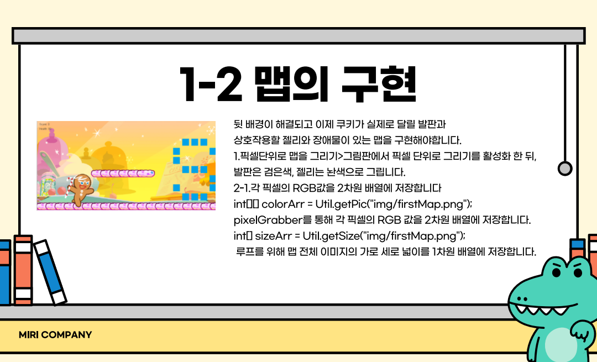
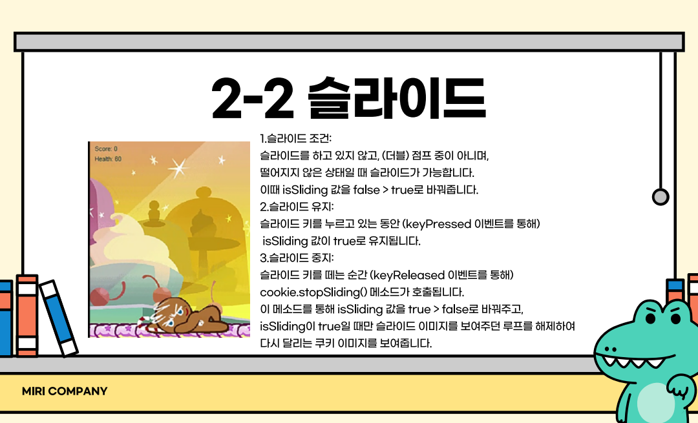
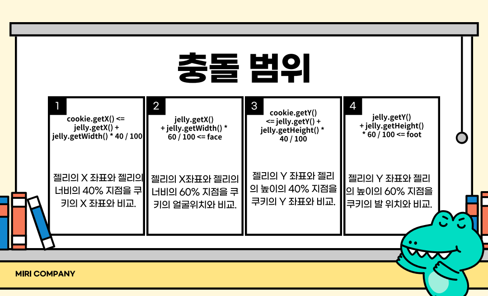

# 쿠키런 모작

**Java 수업에서 만든 PC용 2D 러닝 게임입니다.** 키보드로 점프하거나 슬라이드하며 발판을 따라 이동하고 젤리를 획득합니다.

[맵 구성](#맵-구성) · [캐릭터 조작](#캐릭터-조작) · [젤리 획득 판정](#젤리-획득-판정)

> 이 저장소는 기말 발표자료에 남은 실행 화면과 구현 설명을 담고 있습니다. 원본 소스는 소실됐습니다.

## 맵 구성

맵으로 쓸 이미지의 픽셀 색을 읽어 발판과 젤리를 배치했습니다. 발표자료에서는 이미지의 RGB 값을 2차원 배열에 저장해 맵을 구성하는 과정을 설명합니다.

## 캐릭터 조작

점프 횟수로 첫 점프와 더블 점프를 구분했습니다. 슬라이드는 공중에 있지 않을 때 시작할 수 있고, 키를 누르는 동안 유지하다가 떼면 달리기 상태로 돌아갑니다.

## 젤리 획득 판정

쿠키와 젤리의 가로·세로 좌표 범위를 비교해 충돌을 판정하고, 젤리를 획득하면 점수에 반영했습니다.

위 이미지는 Java 수업 기말 발표자료에서 발췌했습니다.
